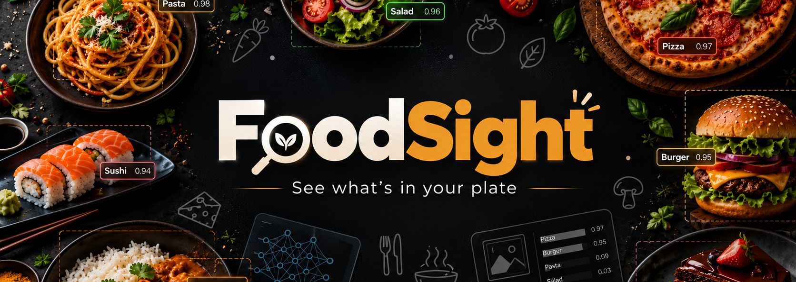

# FoodSight

FoodSight answers one simple question: **what dish is in this photo?** You upload a food photo (or pick one of the bundled examples), and FoodSight tells you which of the 101 dishes from the [Food-101 dataset](https://data.vision.ee.ethz.ch/cvl/datasets_extra/food-101/) it looks most like. Under the hood, it's a pretrained EfficientNet-B0 model that I fine-tuned on food photos.

I built the app with Streamlit and TensorFlow. I didn't want it to just show a single label with no explanation, so it also shows you what the model actually saw: the resized image, its top guess, how confident it is, and its top five guesses.

---

## Live Demo

The whole app is deployed on Streamlit Community Cloud, [check it out here!](https://jhx9yh6q73obk3cqkbsev6.streamlit.app/)

---

## Features

- Recognizes 101 dishes from Food-101
- Accepts PNG, JPG, and JPEG uploads
- Comes with a sample image for every dish, handy if you don't have a photo nearby
- Has quick buttons for popular dishes like pizza, sushi, ramen, and tacos
- Resizes every image to 224 x 224 RGB, the size the model expects
- Shows the top prediction and the top five guesses
- Labels each result `CONFIDENT`, `UNCERTAIN`, or `CONFUSED`, based on the top probability and the gap between the first two guesses
- Shows the resized image the model received next to your original
- Caches the model and the class list, so they're only loaded once
- Wraps prediction in a lock, so if several interactions reach it at once, they take turns instead of colliding

---

## How It Works

Here's what happens between picking an image and seeing a result:

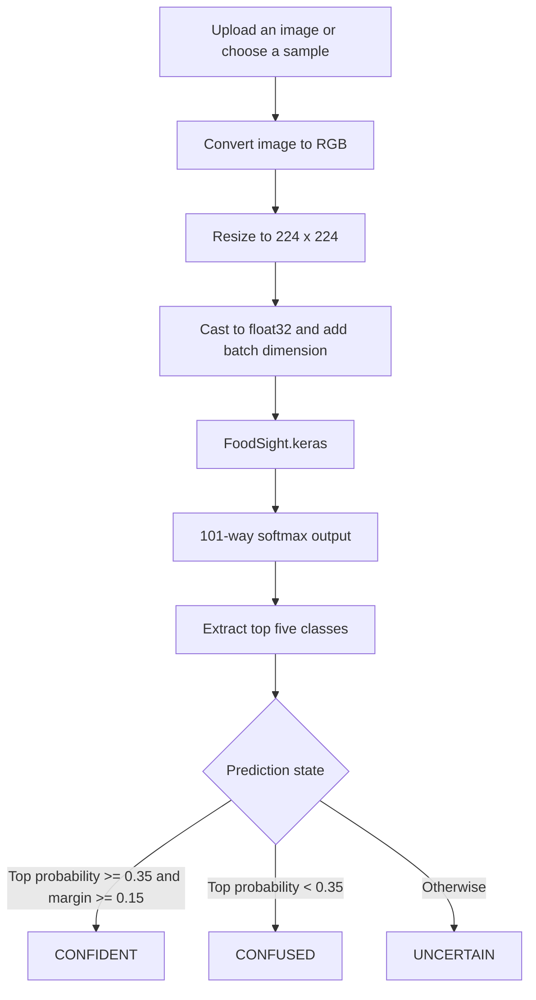

### 1. Choose an image

There are two ways to give FoodSight an image:

- Upload a PNG, JPG, or JPEG with the file uploader.
- Pick a dish from the searchable list or the popular-dish buttons, then load its bundled sample image.

I put one sample JPG for each of the 101 dishes under `assets/samples/`, matching the 101 lines in `utils/class_names.txt`.

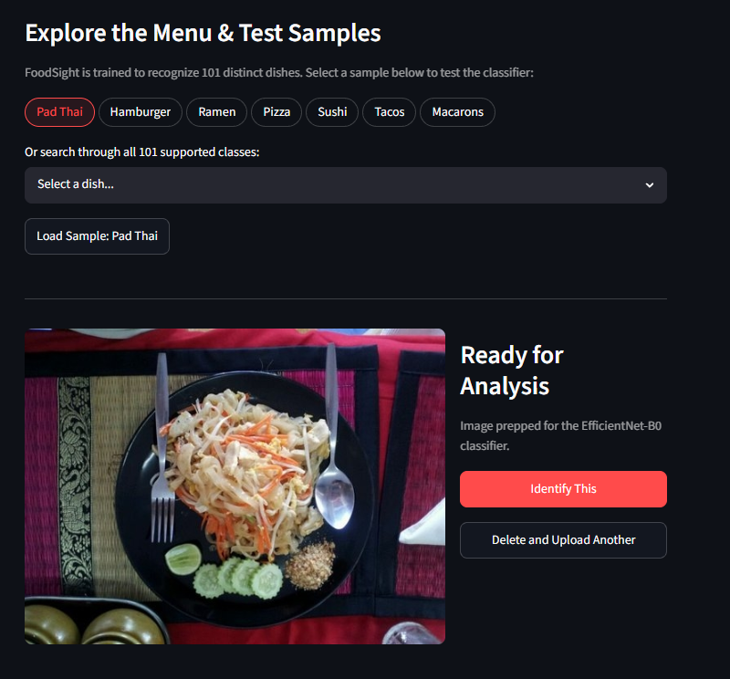

### 2. Prepare the image

Before the image goes to the model, `utils.utilities.preprocess_image()` does five small things:

1. Converts the image to RGB if it isn't already (this covers grayscale images and images with transparency).
2. Turns the PIL image into a TensorFlow tensor.
3. Resizes it to 224 x 224 pixels.
4. Casts the pixel values to `float32`.
5. Adds a batch dimension, so the final shape is `(1, 224, 224, 3)`.

The app also shows a 224 x 224 preview, so you can see what the model is working with. The preview is just for you to look at. What the model actually receives is the `float32` tensor from the preprocessing function.

### 3. Generate predictions

`model/FoodSight.keras` returns 101 numbers, one for each dish in `utils/class_names.txt`. The order matters: the number at position `i` belongs to the dish on line `i` of that file.

The app picks the five largest numbers with TensorFlow's `tf.math.top_k`. The results table shows each of them in two ways:

- **Confidence %**: the value as a percentage, with two decimal places.
- **Confidence Score**: the same value as a number between 0 and 1.

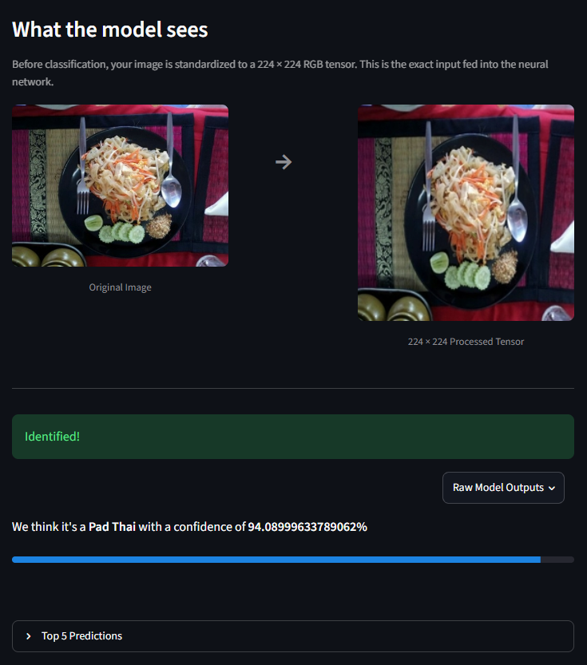
<br>
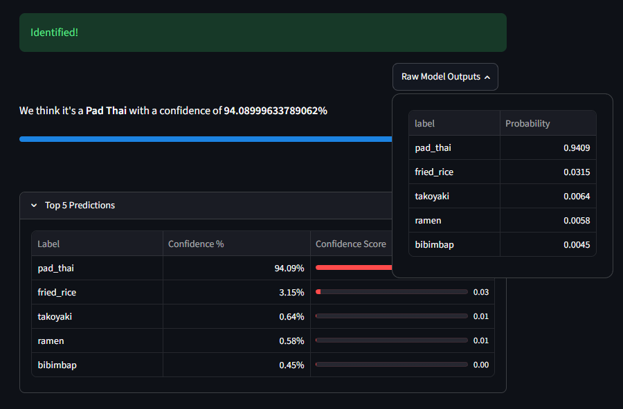

---

## Understanding the Confidence State

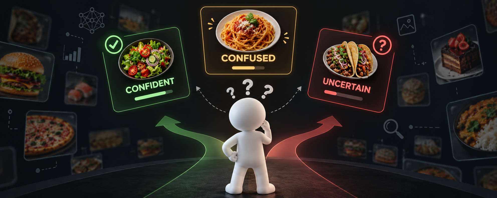

FoodSight doesn't treat every top guess as equally convincing. After finding the top results, it works out how far ahead the first guess is of the second:

```text
margin = probability of first prediction - probability of second prediction
```

Here are the current rules:

| State | Rule | What it means |
|---|---|---|
| `CONFIDENT` | The top probability is at least `0.35` and the margin is at least `0.15` | One dish is strong enough and clearly ahead of the runner-up. |
| `CONFUSED` | The top probability is below `0.35` | No dish scored high enough to give a clear answer. |
| `UNCERTAIN` | Anything else | The top guess may be right, but the runner-up is close enough that it's worth looking at both. |

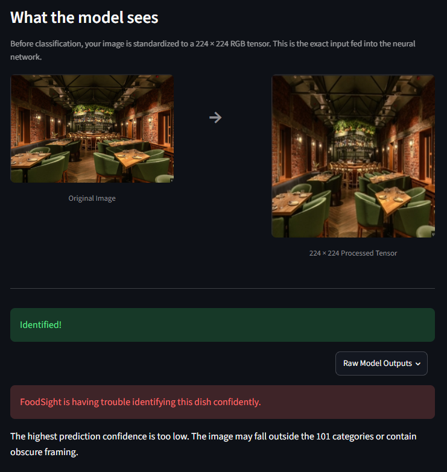
<br>
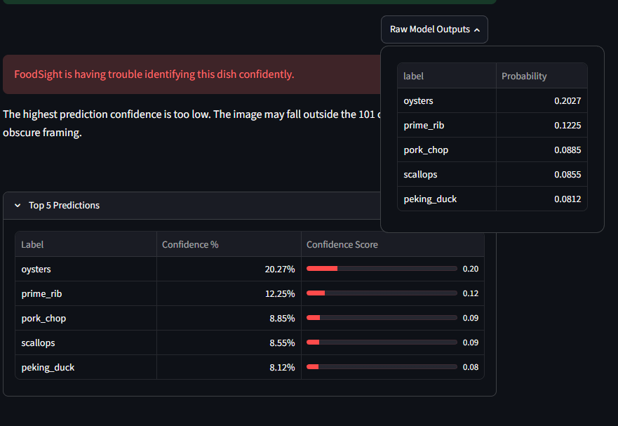

These are display rules I chose for the app, **not** a guarantee that the model is right. The model learned to choose among 101 dishes, and it has no "I don't know this food" option. So a photo of a dish it hasn't learned, a badly framed photo, or a dish that looks a lot like another one will **still** get a best guess.

### Why `0.35` and `0.15`?

These two numbers are rules of thumb. I chose them as sensible starting points, based on common suggestions, and I didn't tune them on data. Here's why they make sense to me.

**Why does the top probability need to be at least `0.35`?**
There are 101 dishes, so a model that was just guessing would give each one about 1% (`1/101`). A top score of `0.35` is roughly 35 times that, which means the model is putting more than a third of its confidence on a single dish. Below that, its confidence is spread across several dishes, so I call the result `CONFUSED`. I didn't use `0.5` ("more likely than not") because with 101 dishes, many of which look alike, that felt too strict for a first guess.

**Why does the margin need to be at least `0.15`?**
The margin is the gap between the first and second guess. A high top score can still be shaky if the runner-up is almost as high. For example, `0.40` against `0.30` has a top score that passes, but a margin of only `0.10`, so the result is `UNCERTAIN` and worth a second look. Requiring a lead of at least 15 percentage points means the runner-up can't be a close contender.

**Why use both?**
Each one catches a different problem. The top probability tells me whether the model is confident at all. The margin tells me whether it's torn between two dishes. Together they separate "one clear winner" from "a weak guess" and "two close candidates".

**Are they perfect?**
No. The scores come from softmax, which isn't calibrated, so `0.35` doesn't mean a 35% chance of being right. The thresholds are a simple way to show you when to be careful, not a guarantee. If I wanted to tune them, I'd run the model on the validation images and check how often each state is actually right, then adjust the numbers.

---

## Why Can Softmax Show `1.0` and Tiny Other Values?

The model's last layer is a softmax. It turns the model's raw scores (called logits) into numbers between 0 and 1 that should add up to 1, so you can read them as probabilities. This is the formula:

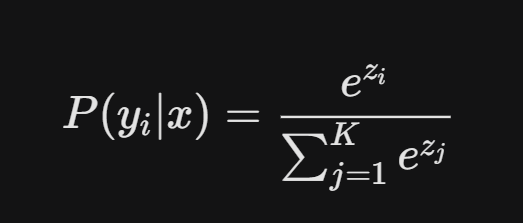

Here, `z` is the list of raw scores.

Once in a while you might see the top guess at exactly `1.0`, the others at tiny values, and a total that comes out slightly above 1. That looks wrong, but it's just how computers handle decimals:

- When the model is very sure, its winning raw score is much bigger than the rest. After softmax, the winner is about `1`, and the others are really small, something like `10^-4` or `10^-5`.
- Computers store numbers with limited precision (`float32` here), so tiny pieces can get rounded away when they're added together. The winner can end up stored as exactly `1.0`, while the losers stay as small positive numbers. Add the stored values up, and you can land a hair above 1.

That doesn't mean the model is producing broken probabilities. It's a tiny rounding error, and it shows up most when the model is very confident.

Two more display details to keep in mind:

- The interface only shows the top five of the 101 outputs. Those five aren't expected to add up to 100%, because the other 96 dishes are left out.
- Percentages are rounded to two decimal places, so the table can differ slightly from the exact values behind the progress bars and the confidence state.

### Want to check it yourself?

The **Raw Model Outputs** popover in the app shows the raw top-five scores. To dig deeper, look at the full output before the top five are picked:

```python
outputs = model.predict(processed_image, verbose=0)[0]
print(outputs.dtype)
print(outputs.sum())
print(outputs.max())
```

The last layer is a softmax, so the sum should be very close to `1.0`. A tiny difference is normal.

---

## Model and Dataset

FoodSight is an EfficientNet-B0 classifier, fine-tuned on the [Food-101 dataset](https://data.vision.ee.ethz.ch/cvl/datasets_extra/food-101/). I started this project to try to beat [DeepFood](https://www.researchgate.net/publication/304163308_DeepFood_Deep_Learning-Based_Food_Image_Recognition_for_Computer-Aided_Dietary_Assessment)'s reported 77.4% top-1 accuracy, and to get some experience with a larger image-classification dataset.

### Dataset

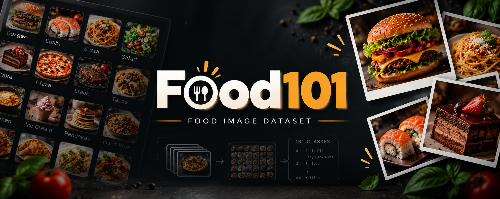

Food-101 has 101 food categories. The training split has 75,750 images (750 per class), and the official validation split has 25,250 images (250 per class). I used 15% of that validation split, which is 3,788 images, for validation during training. The download was about 4.65 GiB, from `TensorFlow Datasets`.

Every image was resized to 224 x 224 pixels and cast from `uint8` to `float32`. I shuffled the training data with a buffer size of 1,000, batched it in groups of 32, and prefetched it with TensorFlow's `AUTOTUNE` (so the next batch is getting ready while the current one trains). The validation data was batched and prefetched but not shuffled, so results stay comparable between experiments.

The model predicts 101 dishes, including:

`apple_pie`, `baklava`, `bibimbap`, `cannoli`, `chicken_curry`, `chocolate_cake`, `french_fries`, `hamburger`, `ice_cream`, `lasagna`, `pizza`, `ramen`, `sushi`, `tacos`, `tiramisu`, `waffles`, and many more.

The full list lives in [`utils/class_names.txt`](utils/class_names.txt), in the same order as the model's outputs. Please don't rename, reorder, or delete entries. If you do, perfectly good predictions will show the wrong dish name.

### Training Setup

I trained the model in two stages. In the first, I kept the pretrained EfficientNet-B0 frozen and trained only a new classification head on top of it. In the second, I unfroze it and fine-tuned the whole thing. A few terms might be new, so I explain them right after the details.

For the first stage, I loaded EfficientNet-B0 without its classification head and froze it. I added a new head with:

- Random horizontal flips, rotations, translations, and contrast changes (data augmentation)
- Global average pooling
- Dropout with a rate of `0.3`
- A dense layer with 101 outputs
- A `float32` softmax activation, so the output probabilities stay stable

Training used TensorFlow's `mixed_float16` mixed precision policy wherever the hardware supported it. I compiled the model with `sparse categorical cross-entropy` loss and the `Adam` optimizer. The first stage ran for 5 epochs with the base model frozen, and ended with `72.78%` validation accuracy and a loss of `0.9974`.

For the second stage, I unfroze the base model and allowed up to 100 epochs. Training stopped on its own after 26. I used model checkpoints, early stopping (after 3 validation-loss evaluations without improvement), and `ReduceLROnPlateau` with a factor of `0.2`, a patience of 2, and a minimum learning rate of `1e-7`.

#### The terms, in plain words

- **Frozen / fine-tuning:** A frozen model's weights don't change during training. First I trained only the new head, then I unfroze the base model and nudged all of it a little, so it could adapt to food photos.
- **Data augmentation:** Random flips, rotations, shifts, and contrast changes make each training photo look a bit different every time, so the model doesn't just memorize the exact images.
- **Dropout:** Randomly switches off 30% of the units in a layer during training, so the model can't lean too heavily on any single one.
- **Mixed precision:** Uses lower-precision numbers where it's safe, which makes training faster and lighter on memory. That's why the final softmax is kept in `float32`.
- **Early stopping:** Stops training once the validation loss hasn't improved for 3 checks in a row.
- **`ReduceLROnPlateau`:** When progress stalls for 2 epochs, the learning rate gets multiplied by 0.2, so the model takes smaller steps as it gets close to a good solution.

### Fine-Tuning Results

I measured these results on the complete Food-101 validation split, all 25,250 images. The model never trained on any of them, but 15% of them (3,788 images) were also the validation data I watched during training, for checkpoints and early stopping. So these numbers are a good sign of how it does on new photos, but it isn't a completely untouched test set.

| Metric | Score |
|---|---:|
| Accuracy | 82.68% |
| Precision | 82.59% |
| Recall | 82.68% |
| F1 score | 82.59% |
| Loss | 0.6266 |

That's 5.28 percentage points above the 77.4% top-1 accuracy reported by [DeepFood](https://www.researchgate.net/publication/304163308_DeepFood_Deep_Learning-Based_Food_Image_Recognition_for_Computer-Aided_Dietary_Assessment). It isn't a like-for-like comparison, though. I didn't reproduce their evaluation setup, so please don't read it as a controlled head-to-head.

### Confusion Matrix

The confusion matrix shows how the model does on each dish. Dishes appear in the same order as [`utils/class_names.txt`](utils/class_names.txt).

It’s computed on the same 25,250 validation images as the metrics above.

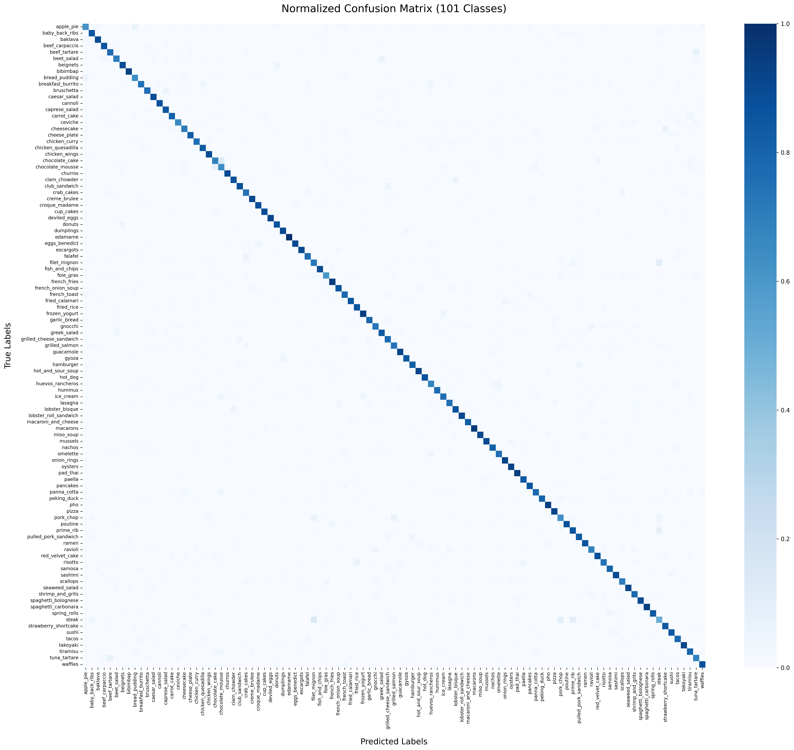

**What I notice:**

*   **A strong diagonal:** The dark blue line running from top-left to bottom-right means the model gets the right answer for most of the 101 dishes. That matches the 82.68% validation accuracy.
*   **Normalized scale:** The matrix runs from 0.0 to 1.0 and shows the share of each dish's images that were classified correctly. The diagonal is consistently dark, so the accuracy looks fairly evenly spread, not carried by a few easy dishes.
*   **Scattered mistakes:** The pale spots off the diagonal are occasional misclassifications. I don't see any dark off-diagonal clusters, so the model doesn't seem to keep guessing one particular wrong dish.
*   **Dishes that look alike:** The scattered noise is what I'd expect from Food-101, where dishes with similar plating, textures, and colors (chocolate cake versus chocolate mousse, for example) share a lot visually.

---

## Repository Structure

```text
Food-Sight/
├── app.py                    # Streamlit user interface and inference flow
├── model/
│   └── FoodSight.keras       # Saved TensorFlow/Keras classifier
├── utils/
│   ├── __init__.py
│   ├── class_names.txt       # 101 class names in model-output order
│   └── utilities.py          # Preprocessing, top-k extraction, state logic
├── assets/
│   ├── docImages/            # Documentation images, including the confusion matrix
│   ├── samples/              # One JPG sample for each supported class
│   └── silc_readme.md        # README from the earlier SILC project
├── requirements.txt          # Runtime dependencies
├── pyproject.toml            # Project metadata and dependency constraints
├── model prob reaching.txt   # Notes on softmax floating-point behavior
├── LICENSE
└── README.md
```

---

## Local Setup

### Requirements

- Python 3.11 or newer
- A CPU that can run TensorFlow inference
- Enough disk space for the TensorFlow runtime and the saved model

### Install

From the repository root:

```bash
python3 -m venv .venv
.venv/bin/python -m pip install --upgrade pip
.venv/bin/python -m pip install -r requirements.txt
```

The dependencies are Streamlit, Pillow, TensorFlow CPU, and NumPy. The project metadata in `pyproject.toml` also asks for Python `>=3.11`.

### Run

```bash
.venv/bin/streamlit run app.py --server.address=0.0.0.0 --server.port=8501
```

Then open [http://localhost:8501](http://localhost:8501) in your browser. The first time, Streamlit loads and caches the Keras model, and TensorFlow needs a moment to warm up, so the first prediction on a CPU can feel a little slow.

---

## API and Inference Notes

FoodSight is a Streamlit app, not a separate REST API. Predictions happen inside the Streamlit process when you press **Identify This**.

The core of the inference code looks like this:

```python
processed_image = utilities.preprocess_image(image)
predictions = model.predict(processed_image)
top_predictions = utilities.top_k_preds(predictions)
```

`top_k_preds()` returns five dictionaries, each with a `label` and a raw `confidence` value. The UI keeps the raw value as `Probability` and converts a copy to a percentage for display.

---

## Limitations

FoodSight isn't perfect, and I'd rather you know where it struggles:

- **Fixed set of dishes:** It can only choose among the 101 Food-101 categories, so it can't reliably identify a dish outside them.
- **Always a best guess:** Softmax spreads its scores across the dishes it knows, so a high score isn't proof that the photo belongs to the dataset.
- **Dishes that look alike:** Similar colors, textures, or plating can be hard to tell apart, like chocolate cake and chocolate mousse.
- **Framing and photo quality:** Heavy cropping, poor lighting, packaging, clutter, or a dish that fills only a small part of the photo can all hurt accuracy.
- **Resizing loses detail:** Every image is shrunk to 224 x 224, so very small details can disappear or get distorted.
- **Confidence isn't calibrated:** The score is the model's softmax output, not a carefully calibrated chance of being correct. A score of 90% doesn't mean it's right 90% of the time.

---

## Good Input Practices

To give FoodSight its best chance of seeing what's on your plate:

- Keep the dish as the main subject, near the center.
- Use a clear, well-lit photo where plenty of the dish is visible.
- Avoid hands, wrappers, or utensils covering most of the food.
- Pick an angle that shows the dish's usual shape and texture.
- If you get `CONFUSED` or `UNCERTAIN`, look at the top five alternatives instead of treating the first guess as the answer.

---

## Acknowledgements

FoodSight wouldn't exist without these open-source projects, datasets, and resources:

- The [Food-101 dataset](https://data.vision.ee.ethz.ch/cvl/datasets_extra/food-101/) by Lukas Bossard, Matthieu Guillaumin, and Luc Van Gool, which provides the 101 food categories and the images I used for training and evaluation.
- [TensorFlow Datasets](https://www.tensorflow.org/datasets), which I used to get and prepare the Food-101 data for training.
- [TensorFlow](https://www.tensorflow.org/) and [Keras](https://keras.io/), for training and running the model.
- [EfficientNet](https://arxiv.org/abs/1905.11946), specifically EfficientNet-B0, the image-classification backbone behind FoodSight.
- [Streamlit](https://streamlit.io/), which powers the web app and its deployment.
- [Pillow](https://python-pillow.org/) and [NumPy](https://numpy.org/), for loading images and preparing inputs.
- [DeepFood](https://www.researchgate.net/publication/304163308_DeepFood_Deep_Learning-Based_Food_Image_Recognition_for_Computer-Aided_Dietary_Assessment), whose reported results gave me a target to aim for.

---

## License

See [`LICENSE`](LICENSE) for the project's license terms.
